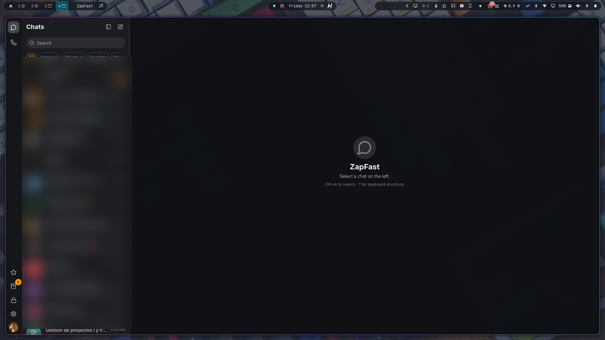

# Omarchy ZapFast

Native [Omarchy](https://omarchy.org/) status bar control suite and widget for [ZapFast](https://zapfast.rocks) (the fast, native Rust WhatsApp desktop client).

**Omarchy ZapFast** brings the lightweight performance of [ZapFast](https://zapfast.rocks) into the Omarchy desktop shell (Hyprland + Quickshell), inspired by the bar widget pattern of [PrettyZap](https://github.com/prettyletto/prettyzap) but re-engineered from the ground up for ZapFast's native architecture, Hyprland window dispatchers, and Linux D-Bus desktop standards.

[](CHANGELOG.md)
[](LICENSE)
[](https://omarchy.org)
[](https://zapfast.rocks)



---

## ✨ Features

- 🟢 **Native Status Bar Widget**: Minimalist, theme-adaptive bar icon with glowing ambient halos when ZapFast is running in the background.
- 🪟 **Smart Window Toggle & Tray Support**:
  - **Left-Click** smart action: Launches ZapFast if closed, focuses and surfaces the window if hidden in the tray or on another workspace, or cleanly sends it to the tray if currently open.
  - Native **Hyprland Lua** integration (`hl.dsp.window.close({ window = 'class:zapfast' })`) to close the window into the tray without killing the background process or losing your WhatsApp session.
- 🔔 **Real-Time Unread Badges**:
  - Live unread message counter badge (`3`, `99+`) rendered directly on the status bar icon.
  - Listens to native Linux desktop `com.canonical.Unity.LauncherEntry` D-Bus signals emitted by ZapFast's `fastframe-dock`.
  - Configurable unread modes: **Count** (numeric pill badge), **Highlight** (recolors icon with bar urgent accent), or **None**.
- 🎨 **Omarchy Theme Synchronization**:
  - **Middle-Click** anywhere on the widget to trigger immediate theme palette synchronization (`zapfast reload-themes`).
  - Reads `~/.config/zapfast/settings.json` reactively with Quickshell `FileView` to reflect active appearance.
- 📋 **Native Control Panel (`PopupCard`)**:
  - **Right-Click** opens a sleek popup card with live status (*Open*, *In tray*, *Closed*, *Not installed*).
  - Quick actions: *Open / Hide ZapFast*, *Reload Omarchy Theme*, *Unread mode toggle*, and *Quit ZapFast*.

---

## 📋 Requirements

1. **Omarchy Linux** (v4+) with the Quickshell-based shell.
2. **Hyprland** Wayland compositor.
3. [ZapFast](https://zapfast.rocks) installed on your system:
   ```bash
   yay -S --needed zapfast-bin
   ```

---

## 🚀 Installation

### Using the Omarchy Plugin Manager

```bash
# Add the plugin and enable it
omarchy plugin add https://github.com/JeffCortez23/omarchy-zapfast.git --enable

# Move the widget to your preferred bar section (right, center, or left)
omarchy bar move io.github.jeffcortez23.omarchy-zapfast --section right
```

### Manual Installation

Clone into your user plugins folder:

```bash
git clone https://github.com/JeffCortez23/omarchy-zapfast.git ~/.config/omarchy/plugins/io.github.jeffcortez23.omarchy-zapfast
omarchy plugin enable io.github.jeffcortez23.omarchy-zapfast
```

---

## 🖱️ Mouse Controls

| Action | Result |
| :--- | :--- |
| **Left Click** | **Smart Toggle**: Launch / Focus window / Send to tray |
| **Middle Click** | **Reload Theme**: Sync active Omarchy palette to ZapFast |
| **Right Click** | **Popup Card**: Open native control panel and quick actions |

---

## ⚙️ Configuration

In your `~/.config/omarchy/shell.json`, you can customize the widget under its entry:

```json
{
  "id": "io.github.jeffcortez23.omarchy-zapfast",
  "icon": "glyph",
  "badge": "Count",
  "launchCommand": "uwsm-app -- zapfast"
}
```

### Options

| Key | Type | Default | Description |
| :--- | :--- | :--- | :--- |
| `icon` | `string` | `"glyph"` | `"glyph"` (WhatsApp symbol) or `"brand"` (ZapFast official logo). |
| `badge` | `enum` | `"Count"` | `"Count"` (draws numeric badge), `"Highlight"` (recolors glyph), or `"None"`. |
| `launchCommand` | `string` | `"uwsm-app -- zapfast"` | Command used to launch ZapFast when not running. |

---

## 🛠️ Architecture & Technical Details

- **IPC & Window Management**: Unlike web wrappers that rely on Electron IPC, ZapFast is a native Rust + `egui` binary. This plugin interfaces with Hyprland via Omarchy's native Lua dispatchers and ZapFast's single-instance UNIX socket.
- **D-Bus Signal Interception**: Listens to session bus signals on `/com/canonical/unity/launcherentry/fastframe` via a non-blocking `busctl` stream, providing instant unread counts without polling.
- **Theme Bridge**: Bridges Omarchy's JSON color templates directly to ZapFast's theme loader in `~/.config/zapfast/themes/omarchy.json`.

---

## 📄 License

MIT © [Jeff Cortez](https://github.com/JeffCortez23)

---

## 🙏 Credits

- [ZapFast](https://zapfast.rocks) by Carmine (`crmne/zapfast`).
- [PrettyZap](https://github.com/prettyletto/prettyzap) by Prettyletto for the visual bar widget concept.
